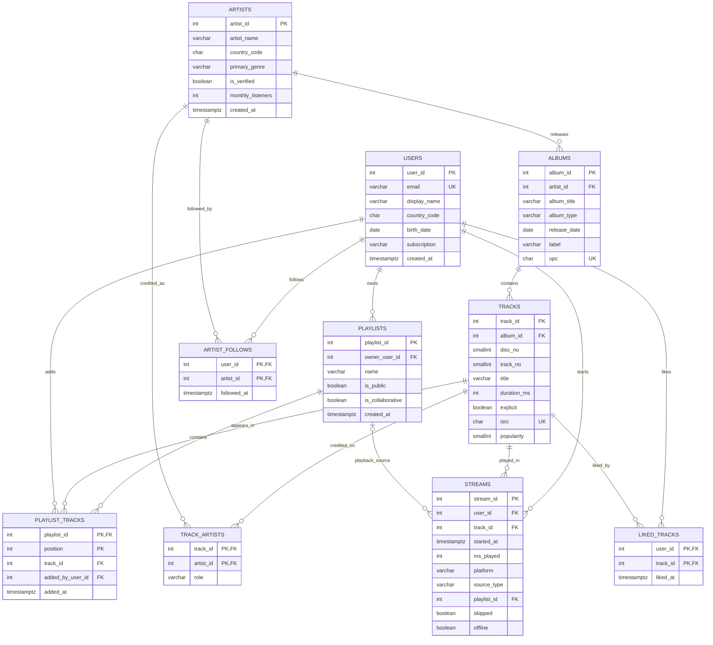

# Spotify Database — Schema Design

**Project:** Spotify Music Streaming Database  
**Database:** PostgreSQL  
**Schema:** `spotify`  
**Source:** The 10 supplied CSV exports. The design uses their exact table and column names.

The schema is inferred from the seed data and the Phase 2 requirements in `README.md`. Constraints are limited to primary keys, foreign keys, unique, not-null and check constraints. No manually created performance indexes are included.

## 1. Data overview

| CSV / table | Rows | Purpose |
|---|---:|---|
| `artists` | 3,000 | Artist and band profiles |
| `albums` | 12,000 | Albums, EPs, singles and compilations |
| `tracks` | 67,808 | Recordings belonging to albums |
| `track_artists` | 77,489 | Primary and featured artist credits |
| `users` | 30,000 | Listener accounts |
| `playlists` | 10,000 | User-created playlists |
| `playlist_tracks` | 120,004 | Ordered playlist entries |
| `streams` | 250,000 | Individual listening events |
| `liked_tracks` | 58,533 | User-liked tracks |
| `artist_follows` | 69,901 | User-to-artist follows |
| **Total** | **644,735** | |

The counts above were read from the supplied CSV files. The load script prints database row counts so they can be verified after import.

## 2. Data dictionary

### 2.1 Type choices

| Data | PostgreSQL type | Reason |
|---|---|---|
| IDs and general counts | `INTEGER` | All supplied IDs and counts fit within the integer range. |
| Small positions and scores | `SMALLINT` | Disc number, track number and popularity have small ranges. |
| Dates without time | `DATE` | Used for birth dates and album release dates. |
| Timestamps with offsets | `TIMESTAMPTZ` | The CSV timestamps include `+05:30`; this type preserves the represented instant. |
| Yes/no values | `BOOLEAN` | CSV values are `t` and `f`. |
| Names and categories | `VARCHAR(n)` | Human-readable text with a practical maximum length. |
| UPC and ISRC | `CHAR(12)` | Fixed-length identifiers; they are not numeric values. |

`PK` = primary key · `FK` = foreign key · `NN` = NOT NULL · `UQ` = UNIQUE · `CK` = CHECK.

### 2.2 `artists` — 3,000 rows

Stores artist and band profiles.

| Column | Type | Constraints | Reason |
|---|---|---|---|
| `artist_id` | `INTEGER` | PK, NN | Identifies an artist. |
| `artist_name` | `VARCHAR(100)` | NN | Display name; names are not assumed unique. |
| `country_code` | `CHAR(2)` | NN, CK | Two-letter uppercase country code. |
| `primary_genre` | `VARCHAR(30)` | NN | Main genre label. |
| `is_verified` | `BOOLEAN` | NN | Verification status. |
| `monthly_listeners` | `INTEGER` | NN, CK ≥ 0 | Supplied listener-count snapshot. |
| `created_at` | `TIMESTAMPTZ` | NN | Profile creation time. |

### 2.3 `albums` — 12,000 rows

Stores albums, EPs, singles and compilations. One artist can be associated with many albums.

| Column | Type | Constraints | Reason |
|---|---|---|---|
| `album_id` | `INTEGER` | PK, NN | Album identifier. |
| `artist_id` | `INTEGER` | FK → `artists.artist_id`, NN | Artist associated with the album. |
| `album_title` | `VARCHAR(150)` | NN | Album title; not unique. |
| `album_type` | `VARCHAR(20)` | NN, CK | One of the four supplied album types. |
| `release_date` | `DATE` | NN | Release calendar date. |
| `label` | `VARCHAR(100)` | NN | Record label. |
| `upc` | `CHAR(12)` | NN, UQ, CK | Twelve-digit product identifier, stored as text. |

### 2.4 `tracks` — 67,808 rows

Stores recordings belonging to albums.

| Column | Type | Constraints | Reason |
|---|---|---|---|
| `track_id` | `INTEGER` | PK, NN | Track identifier. |
| `album_id` | `INTEGER` | FK → `albums.album_id`, NN | Album containing the track. |
| `disc_no` | `SMALLINT` | NN, CK ≥ 1 | Disc number within the album. |
| `track_no` | `SMALLINT` | NN, CK ≥ 1 | Position on the disc. |
| `title` | `VARCHAR(200)` | NN | Track title. |
| `duration_ms` | `INTEGER` | NN, CK > 0 | Duration in milliseconds. |
| `explicit` | `BOOLEAN` | NN | Explicit-content flag. |
| `isrc` | `CHAR(12)` | NN, UQ, CK | Recording identifier. |
| `popularity` | `SMALLINT` | NN, CK 0–100 | Bounded popularity score. |

**Additional candidate key:** (`album_id`, `disc_no`, `track_no`) is UNIQUE, so two tracks cannot occupy the same position on one album.

### 2.5 `track_artists` — 77,489 rows

Resolves the many-to-many relationship between tracks and artists, including featured artists.

| Column | Type | Constraints | Reason |
|---|---|---|---|
| `track_id` | `INTEGER` | PK part, FK → `tracks.track_id`, NN | Credited track. |
| `artist_id` | `INTEGER` | PK part, FK → `artists.artist_id`, NN | Credited artist. |
| `role` | `VARCHAR(10)` | NN, CK | Credit role: `PRIMARY` or `FEATURED`. |

**Composite primary key:** (`track_id`, `artist_id`) prevents duplicate credits for the same artist-track pair.

### 2.6 `users` — 30,000 rows

Stores listener accounts and subscription information.

| Column | Type | Constraints | Reason |
|---|---|---|---|
| `user_id` | `INTEGER` | PK, NN | Listener identifier. |
| `email` | `VARCHAR(254)` | NN, UQ | Account email; unique in the supplied data. |
| `display_name` | `VARCHAR(100)` | NN | Display name; not unique. |
| `country_code` | `CHAR(2)` | NN, CK | Two-letter uppercase country code. |
| `birth_date` | `DATE` | NN | Date of birth, relevant to age-related compliance queries. |
| `subscription` | `VARCHAR(20)` | NN, CK | One of the supplied subscription tiers. |
| `created_at` | `TIMESTAMPTZ` | NN | Account creation timestamp. |

### 2.7 `playlists` — 10,000 rows

Stores playlist metadata and its owner. One user can own multiple playlists.

| Column | Type | Constraints | Reason |
|---|---|---|---|
| `playlist_id` | `INTEGER` | PK, NN | Playlist identifier. |
| `owner_user_id` | `INTEGER` | FK → `users.user_id`, NN | Playlist owner. |
| `name` | `VARCHAR(150)` | NN | Playlist name; names can repeat. |
| `is_public` | `BOOLEAN` | NN | Public visibility flag. |
| `is_collaborative` | `BOOLEAN` | NN | Collaborative editing flag. |
| `created_at` | `TIMESTAMPTZ` | NN | Playlist creation time. |

A playlist cannot be both public and collaborative in the supplied dataset; this rule is enforced with a CHECK constraint.

### 2.8 `playlist_tracks` — 120,004 rows

Stores ordered playlist entries, including who added each track. A track can appear more than once in a playlist at different positions.

| Column | Type | Constraints | Reason |
|---|---|---|---|
| `playlist_id` | `INTEGER` | PK part, FK → `playlists.playlist_id`, NN | Playlist containing the entry. |
| `position` | `INTEGER` | PK part, NN, CK ≥ 1 | Position within the playlist. |
| `track_id` | `INTEGER` | FK → `tracks.track_id`, NN | Track in the entry. |
| `added_by_user_id` | `INTEGER` | FK → `users.user_id`, NN | User who added the entry. |
| `added_at` | `TIMESTAMPTZ` | NN | Time the track was added. |

**Composite primary key:** (`playlist_id`, `position`). (`playlist_id`, `track_id`) is deliberately not unique because repeated tracks are present in the CSV.

### 2.9 `streams` — 250,000 rows

Stores each individual listening event.

| Column | Type | Constraints | Reason |
|---|---|---|---|
| `stream_id` | `INTEGER` | PK, NN | Unique stream event. |
| `user_id` | `INTEGER` | FK → `users.user_id`, NN | Listener who streamed the track. |
| `track_id` | `INTEGER` | FK → `tracks.track_id`, NN | Track that was streamed. |
| `started_at` | `TIMESTAMPTZ` | NN | Stream start time. |
| `ms_played` | `INTEGER` | NN, CK ≥ 0 | Milliseconds played; zero occurs in the data. |
| `platform` | `VARCHAR(20)` | NN, CK | Playback platform. |
| `source_type` | `VARCHAR(20)` | NN, CK | Source from which playback began. |
| `playlist_id` | `INTEGER` | FK → `playlists.playlist_id`, NULL allowed | Present only for playlist-source streams. |
| `skipped` | `BOOLEAN` | NN, CK | Must agree with the observed 30-second threshold. |
| `offline` | `BOOLEAN` | NN | Whether playback was offline. |

`playlist_id` is NULL for non-playlist sources. The CSV contains 112,614 `PLAYLIST` streams with a playlist ID and 137,386 non-playlist streams without one.

### 2.10 `liked_tracks` — 58,533 rows

Resolves the many-to-many relationship between users and liked tracks.

| Column | Type | Constraints | Reason |
|---|---|---|---|
| `user_id` | `INTEGER` | PK part, FK → `users.user_id`, NN | User who liked the track. |
| `track_id` | `INTEGER` | PK part, FK → `tracks.track_id`, NN | Liked track. |
| `liked_at` | `TIMESTAMPTZ` | NN | Time of the like. |

**Composite primary key:** (`user_id`, `track_id`) allows one current like record per user-track pair.

### 2.11 `artist_follows` — 69,901 rows

Resolves the many-to-many relationship between users and artists.

| Column | Type | Constraints | Reason |
|---|---|---|---|
| `user_id` | `INTEGER` | PK part, FK → `users.user_id`, NN | User following the artist. |
| `artist_id` | `INTEGER` | PK part, FK → `artists.artist_id`, NN | Followed artist. |
| `followed_at` | `TIMESTAMPTZ` | NN | Time the follow began. |

**Composite primary key:** (`user_id`, `artist_id`) prevents duplicate follow records for the same pair.

## 3. Keys, relationships and delete behaviour

### 3.1 Primary and unique keys

| Table | Primary key | Additional UNIQUE key |
|---|---|---|
| `artists` | `artist_id` | — |
| `albums` | `album_id` | `upc` |
| `tracks` | `track_id` | `isrc`; (`album_id`, `disc_no`, `track_no`) |
| `track_artists` | (`track_id`, `artist_id`) | — |
| `users` | `user_id` | `email` |
| `playlists` | `playlist_id` | — |
| `playlist_tracks` | (`playlist_id`, `position`) | — |
| `streams` | `stream_id` | — |
| `liked_tracks` | (`user_id`, `track_id`) | — |
| `artist_follows` | (`user_id`, `artist_id`) | — |

Artist names, album titles, track titles, playlist names and display names are not unique keys.

### 3.2 Relationships and cardinalities

| Parent | Child | Cardinality | Foreign key |
|---|---|---|---|
| `artists` | `albums` | 1 : N | `albums.artist_id` |
| `albums` | `tracks` | 1 : N | `tracks.album_id` |
| `tracks` | `track_artists` | 1 : N | `track_artists.track_id` |
| `artists` | `track_artists` | 1 : N | `track_artists.artist_id` |
| `users` | `playlists` | 1 : N | `playlists.owner_user_id` |
| `playlists` | `playlist_tracks` | 1 : N | `playlist_tracks.playlist_id` |
| `tracks` | `playlist_tracks` | 1 : N | `playlist_tracks.track_id` |
| `users` | `playlist_tracks` | 1 : N | `playlist_tracks.added_by_user_id` |
| `users` | `streams` | 1 : N | `streams.user_id` |
| `tracks` | `streams` | 1 : N | `streams.track_id` |
| `playlists` | `streams` | 1 : N, optional | `streams.playlist_id` |
| `users` | `liked_tracks` | 1 : N | `liked_tracks.user_id` |
| `tracks` | `liked_tracks` | 1 : N | `liked_tracks.track_id` |
| `users` | `artist_follows` | 1 : N | `artist_follows.user_id` |
| `artists` | `artist_follows` | 1 : N | `artist_follows.artist_id` |

The user-track likes, user-artist follows, track-artist credits and playlist-track relationships are M:N relationships represented by junction tables.

### 3.3 ON DELETE choices

- **CASCADE:** `track_artists`, `liked_tracks`, and `artist_follows` rows are relationship records with no independent meaning after either referenced entity is deleted. `playlist_tracks` entries also cascade when their playlist or track is deleted.
- **RESTRICT:** `albums.artist_id`, `tracks.album_id`, `playlists.owner_user_id`, `playlist_tracks.added_by_user_id`, and all `streams` foreign keys. These preserve catalogue ownership and listening history. A playlist referenced by a stream cannot be deleted; a user or track with stream history cannot be deleted.
- No `SET NULL` action is used. In particular, `streams.playlist_id` must remain present for a `PLAYLIST` source.

### 3.4 Indexes created in Phase 2

No manual performance indexes are created. PostgreSQL automatically creates indexes for primary-key and UNIQUE constraints. Foreign-key declarations do **not** automatically create indexes on the referencing columns. Additional workload indexes belong to Phase 4.

## 4. CHECK constraints

The following rules were checked against the supplied CSV values before being added to `sql/01_schema.sql`.

| # | Table | Rule |
|---:|---|---|
| 1 | `artists` | `country_code` matches `^[A-Z]{2}$`. |
| 2 | `artists` | `monthly_listeners >= 0`. |
| 3 | `users` | `country_code` matches `^[A-Z]{2}$`. |
| 4 | `users` | `subscription` is `FREE`, `PREMIUM`, `DUO`, `FAMILY` or `STUDENT`. |
| 5 | `albums` | `album_type` is `ALBUM`, `EP`, `SINGLE` or `COMPILATION`. |
| 6 | `albums` | UPC contains exactly 12 digits. |
| 7 | `tracks` | `disc_no >= 1`. |
| 8 | `tracks` | `track_no >= 1`. |
| 9 | `tracks` | `duration_ms > 0`. |
| 10 | `tracks` | ISRC matches `^[A-Z]{2}[A-Z0-9]{3}[0-9]{7}$`. |
| 11 | `tracks` | `popularity` is between 0 and 100. |
| 12 | `track_artists` | `role` is `PRIMARY` or `FEATURED`. |
| 13 | `playlists` | A playlist cannot be both public and collaborative. |
| 14 | `playlist_tracks` | `position >= 1`. |
| 15 | `streams` | `ms_played >= 0`. |
| 16 | `streams` | `platform` is one of `ANDROID`, `CAR`, `DESKTOP`, `IOS`, `SPEAKER`, `WEB`. |
| 17 | `streams` | `source_type` is one of `ALBUM`, `ARTIST`, `PLAYLIST`, `RADIO`, `SEARCH`. |
| 18 | `streams` | `playlist_id` is present if and only if `source_type = 'PLAYLIST'`. |
| 19 | `streams` | `skipped` is true if and only if `ms_played < 30000` in this dataset. |

The ISRC pattern is the format observed in this export and is used as a project data-validation rule. The `skipped` rule is also based on the supplied data and the brief's 30-second threshold. Cross-table rules, such as comparing a stream duration with its track duration, are checked separately because a normal row-level CHECK cannot query another table.

## 5. Functional dependencies and normalization

`X → Y` means that knowing X determines Y.

| Table | Main functional dependency |
|---|---|
| `artists` | `artist_id → artist_name, country_code, primary_genre, is_verified, monthly_listeners, created_at` |
| `albums` | `album_id → artist_id, album_title, album_type, release_date, label, upc`; `upc → album_id, ...` |
| `tracks` | `track_id → album_id, disc_no, track_no, title, duration_ms, explicit, isrc, popularity`; (`album_id`, `disc_no`, `track_no`) → the track attributes; `isrc → track_id, ...` |
| `track_artists` | (`track_id`, `artist_id`) → `role` |
| `users` | `user_id → email, display_name, country_code, birth_date, subscription, created_at`; `email → user_id, ...` |
| `playlists` | `playlist_id → owner_user_id, name, is_public, is_collaborative, created_at` |
| `playlist_tracks` | (`playlist_id`, `position`) → `track_id, added_by_user_id, added_at` |
| `streams` | `stream_id → user_id, track_id, started_at, ms_played, platform, source_type, playlist_id, skipped, offline` |
| `liked_tracks` | (`user_id`, `track_id`) → `liked_at` |
| `artist_follows` | (`user_id`, `artist_id`) → `followed_at` |

- **1NF:** Each field stores one value. Multi-valued relationships are represented as rows in junction tables rather than lists in a column.
- **2NF:** In tables with composite primary keys, the non-key attributes depend on the complete key. For example, `liked_at` depends on both `user_id` and `track_id`.
- **3NF / BCNF:** The entity and junction tables are in 3NF/BCNF based on the candidate keys and dependencies above. `streams` has one deliberate derived attribute: in the supplied data, `ms_played` determines `skipped` through the 30-second rule. If this is treated as a permanent business dependency, `streams` is not strictly 3NF. The source column is retained for compatibility with the supplied schema and workload, and a CHECK keeps the values consistent.

### 5.1 Derived or potentially redundant columns

- **`artists.monthly_listeners`:** This is a changing aggregate metric. The supplied tables do not define its calculation window or complete aggregation logic, so it cannot reliably be recomputed from this export. Keep it as the supplied snapshot.
- **`streams.skipped`:** It is derivable from `ms_played` in the supplied data: `skipped = true` exactly when fewer than 30,000 ms were played. Keep it because it is an explicit source column; enforce consistency with a CHECK.
- **`albums.artist_id` and `track_artists.role = 'PRIMARY'`:** Both store the primary-artist association at different levels. In the supplied data, the primary track artist matches the album artist for every track. Keep both: `albums.artist_id` describes the album, while `track_artists` represents all track credits, including featured artists. The cross-table match is verified after loading.

## 6. Data inspection and integrity checks

The figures below were calculated from the supplied CSV files. They are **CSV inspection results**, not a claim that PostgreSQL has already been run. Run the checks after loading and compare the database output.

### 6.1 Data observations

| Observation | CSV result | Design impact |
|---|---:|---|
| NULL `streams.playlist_id` | 137,386 rows | Column must be nullable for non-playlist sources. |
| `PLAYLIST` source streams | 112,614 rows | These rows have a playlist ID. |
| Repeated (`playlist_id`, `track_id`) pairs | 1,800 | Do not make that pair UNIQUE; use playlist position in the PK. |
| Playlist entries added by someone other than owner | 3,497 | Keep `added_by_user_id` separate from `owner_user_id`. |
| Collaborative playlists | 968 | All are private in this export. |
| Collaborative and public at the same time | 0 | The visibility CHECK accepts all rows. |
| Streams with `ms_played = 0` | 3 | Allow zero; CHECK must be `>= 0`. |
| Tracks without exactly one PRIMARY credit | 0 | All 67,808 tracks have one primary artist. |
| Primary track artist differs from album artist | 0 | All primary credits match `albums.artist_id`. |
| Streams longer than track duration | 0 | No such rows were found. |
| Streams before the track's album release date | 0 | No such rows were found. |
| Album release date before artist profile creation date | 2,598 | Do not enforce this as a constraint; an artist profile may post-date an earlier release. |

### 6.2 Integrity queries

**Check 1 — Every track has exactly one PRIMARY artist.**

```sql
SELECT COUNT(*) AS tracks_with_invalid_primary_count
FROM (
    SELECT t.track_id
    FROM spotify.tracks AS t
    LEFT JOIN spotify.track_artists AS ta
      ON ta.track_id = t.track_id
    GROUP BY t.track_id
    HAVING COUNT(*) FILTER (WHERE ta.role = 'PRIMARY') <> 1
) AS invalid_tracks;
```

Expected from CSV inspection: **0**.

**Check 2 — A stream does not exceed the track duration.**

```sql
SELECT COUNT(*) AS streams_exceeding_track_duration
FROM spotify.streams AS s
JOIN spotify.tracks AS t ON t.track_id = s.track_id
WHERE s.ms_played > t.duration_ms;
```

Expected from CSV inspection: **0**.

**Check 3 — Playlist ID agrees with the stream source.**

```sql
SELECT COUNT(*) AS invalid_playlist_source_rows
FROM spotify.streams
WHERE (source_type = 'PLAYLIST' AND playlist_id IS NULL)
   OR (source_type <> 'PLAYLIST' AND playlist_id IS NOT NULL);
```

Expected from CSV inspection: **0**.

**Check 4 — Primary track artist agrees with the album artist.**

```sql
SELECT COUNT(*) AS primary_album_artist_mismatches
FROM spotify.tracks AS t
JOIN spotify.albums AS a ON a.album_id = t.album_id
JOIN spotify.track_artists AS ta
  ON ta.track_id = t.track_id
 AND ta.role = 'PRIMARY'
WHERE ta.artist_id <> a.artist_id;
```

Expected from CSV inspection: **0**.

**Check 5 — Stream skip flag agrees with the 30-second threshold.**

```sql
SELECT COUNT(*) AS skipped_threshold_mismatches
FROM spotify.streams
WHERE skipped <> (ms_played < 30000);
```

Expected from CSV inspection: **0**.

## 7. ER diagram



## 8. Build and load

Run both scripts from the repository root. The `seed_data/` directory must contain the ten CSV files.

```bash
createdb spotify_db
psql -d spotify_db -v ON_ERROR_STOP=1 -f sql/01_schema.sql
psql -d spotify_db -v ON_ERROR_STOP=1 -f sql/02_load_data.sql
```

The load order is parents before dependent rows:

`artists → users → albums → playlists → tracks → track_artists → playlist_tracks → liked_tracks → artist_follows → streams`

`02_load_data.sql` runs `ANALYZE` and prints a row-count result for all ten tables. Confirm that the counts match Section 1 before recording the load as successful.

**Execution status:** The schema and load scripts have been prepared and checked against the CSV values. PostgreSQL execution must still be performed in the project environment; do not mark the load as successful until both commands complete without errors.
